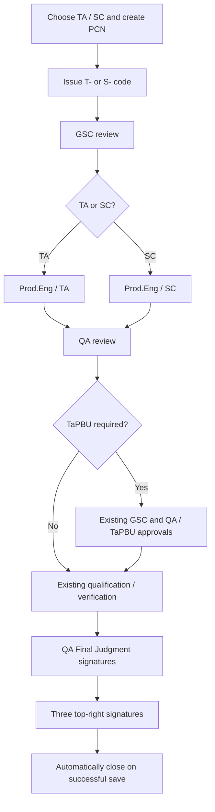

# TA / SC PCN flow redesign

Date: 2026-11-19. Status: implemented locally, migration 009 applied after approval. The first code is issued only after an explicit **Save draft** click. Verification and activation evidence are in [the implementation record](ta-sc-pcn-implementation.md).

## Confirmed requirements

- Two document routing types: **TA** and **SC**.
- TA uses `T-ddmmyy01`; SC uses `S-ddmmyy01`.
- Each type has its own daily counter, starting at `01` each day.
- The existing review flow stays the same except that TA and SC route to separate Production Engineering groups.
- The creator selects TA/SC and the server issues the code when the PCN is first created. This is the user's latest choice and supersedes the preceding GSC-issuance selection.
- PCN Records includes a PCN-type filter alongside the existing Supplier, Department and date filters.

TA/SC is independent of the existing Form-1 Raw Material / Form-2 Packaging choice. Either layout can belong to either routing type.

## Proposed workflow

GSC, QA and TaPBU stay shared in this proposal; only Production Engineering splits. The saved source diagram mentions TA/SC selection for both PE and QA, but the current request explicitly splits PE only. No second QA group is assumed.

Each PCN passes through **one** Production Engineering team. The document keeps one Prepared / Checked / Approved PE signature block, labelled with its responsible TA or SC team. Existing prerequisite, risk, TaPBU skip, document-check, version and closure rules remain in force.

## Numbering

Examples for 19 November 2026:

| Type | First issued code | Next code | Responsible PE team |
| --- | --- | --- | --- |
| TA | `T-19112601` | `T-19112602` | Prod.Eng / TA |
| SC | `S-19112601` | `S-19112602` | Prod.Eng / SC |

The next day's first codes are `T-20112601` and `S-20112601` independently. Proposed date source: the server's Asia/Bangkok calendar date at issuance, never a client-entered date. The exact two-digit suffix supports `01` through `99`; exhaustion must reject issuance rather than wrap or reuse a code. Expanding beyond two digits would require a deliberate format change.

Code allocation must be transactional and unique per type/date. Retrying the same creation request returns the same saved record and code. Deleted or cancelled numbers are not recycled. Copying a PCN creates a new code and carries no signatures.

### Issuance point — creation, confirmed

Choose TA/SC before clicking **Save draft** for the first time. Selection changes and typing stay local until that explicit save, so the creator can correct the type without a code being issued by background autosave. Opening Review or Preview, checking readiness, submitting or attempting an upload cannot silently create the first draft; Save draft is required first. On successful creation, the server atomically reserves the next number from that type's daily counter and issues the code. Later edits autosave using the same identifier. Submission on a later day keeps the original code and creation date. If the first save response is lost, its selected type stays held while Retry recovers the same draft identity.

The typed code is the new record's identifier from creation; existing record identifiers remain valid. Type and code are locked after issuance so the responsible PE team cannot change beneath the document's identity or signatures. Reclassification needs an explicit, separately reviewed revision procedure. No reclassification procedure is included in this initial change.

## Production Engineering separation

- Add separate Prod.Eng / TA and Prod.Eng / SC user assignments under the existing Production Engineering role.
- Preserve Prepared, Checked and Approved assignments for each team.
- A normal TA signer cannot sign the SC PE stage, or vice versa. Existing Administrator/Developer authority remains unchanged.
- Configure separate TA and SC PE notification lists for all three signing steps. Never fall back silently to the other team's recipients.
- Proposed review-limit setup: separate TA and SC PE limits, initially inheriting the current configured PE allowance. Changing a limit retains the original review handoff clock.
- Keep one canonical record-aware team resolver for signing, next responsibility, email routing and review limits. Preserve the existing PE signature storage path so historical evidence is not remapped.
- Do not automatically give existing PE users both assignments; an administrator configures the new groups explicitly.

## Existing records and compatibility

Existing `PCN-YYYY-NNNN` documents retain their identifiers, links, attachments, signatures and history. Unclassified legacy records retain the existing Prod.Eng/TET route. This design does not authorize a historical code rewrite or automatic reclassification of ongoing documents.

New codes must be supported consistently by creation, record/form routes, API validation, attachment/revision endpoints, search, CSV, printed documents, Developer Tools, notification links and Teams link extraction. New typed record codes and existing `PCN-YYYY-NNNN` identifiers must both remain supported.

## PCN Records type filter

Add a **PCN type** dropdown to the shared Portal and read-only Records filter toolbar, beside the existing Supplier and Department filters.

| Option | Matching documents |
| --- | --- |
| All types | All authorized records, including existing legacy documents |
| TA | Records with the saved TA document type and `T-` code |
| SC | Records with the saved SC document type and `S-` code |
| Legacy / unassigned | Existing documents without a TA/SC classification |

- Apply the filter to both Open and Closed tabs and preserve its selection when switching tabs or polling.
- Combine it with search, status, risk, supplier, department and date filters; do not replace those controls.
- Filter by the saved document type. Do not guess TA/SC from the material, form layout or current responsible department.
- Update matching rows, matching-record counts, pagination, filtered CSV and printed record lists. Retain the existing overall Open/Closed badge-count behavior.
- Save the type selection in account-scoped saved views. Existing saved views with no type field default to All types.
- Reset filters returns the dropdown to All types while preserving the current Open/Closed tab.
- Keep legacy records visible under All types and Legacy / unassigned; filtering performs no data reclassification or permission changes.
- Show a clear empty result when no records match the combined filters.

## Implementation outline

1. Add mandatory TA/SC selection before creation, with server-issued typed identifiers; retain support for all existing record identifiers.
2. Add a shared legacy/new code parser, document type validation and transactional type/date counters through an explicit new migration.
3. Add the two PE assignments and central record-aware stage/team resolver; preserve legacy assignments.
4. Extend mail configuration and review limits for each PE team.
5. Update creation, form labels, Records (including the PCN-type filter), search/export, print and links without changing form-layout choices.
6. Test concurrent issuance, Bangkok midnight boundaries, retry idempotency, cross-team signing denial, isolated recipients, existing-code compatibility, unchanged closure and A4 printing. Include combined type filters, Open/Closed switching, saved views, reset, CSV/print scope and legacy/empty results.

Migration 009 was approved and applied; see [activation evidence](ta-sc-pcn-implementation.md#operational-activation--completed-2026-11-19). Signed runtime deployment remains separate.
